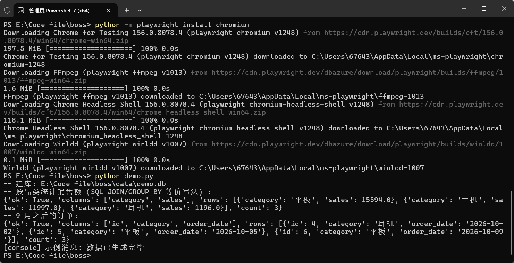
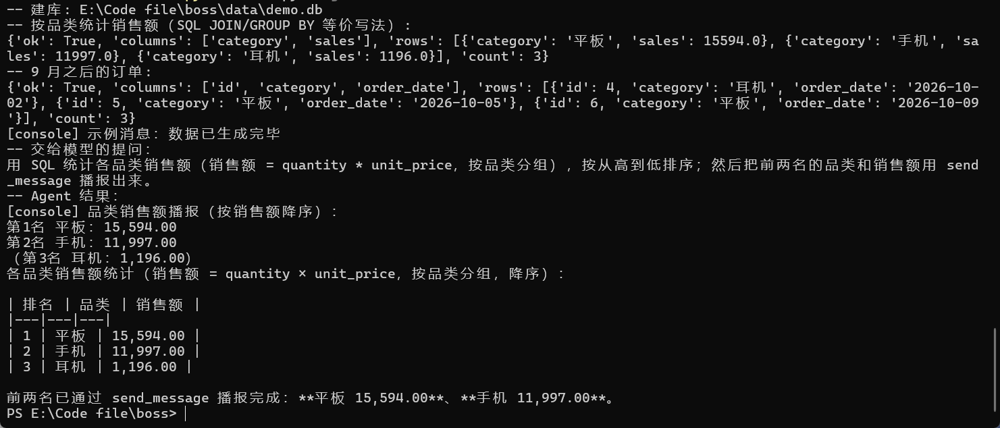

# boss-toolkit

[](https://github.com/yuancii/boss-toolkit/actions/workflows/test.yml)

面向「AI 应用开发 / RPA 交付」方向的 Python 练习项目：**大模型 API 调用 + 工具函数封装 + 网页自动化 + 数据库查询**。

所有代码只用 `requests` 与标准库完成核心逻辑（不依赖各家 SDK），方便看清调用细节。

## 功能

| 模块 | 内容 |
|---|---|
| `llm_client.py` | DeepSeek（OpenAI 兼容）API 封装：`chat()` 同步、`chat_stream()` 流式、`call_with_tools()` Function Calling |
| `tools.py` | 三个可被 Agent 调用的函数：`send_message` / `read_excel` / `query_sql`，含 OpenAI `tools` 描述 |
| `demo.py` | 端到端演示：生成示例 SQLite 库 → 直接调工具 → 可选走 Agent 完成"统计 + 播报" |
| `automation.py` | Playwright 网页自动化：打开页面、抓取链接、导出 CSV（utf-8-sig，Excel 可直接打开） |
| `tests/` | pytest 单测：工具函数正常/异常分支（11 个用例） |

## 快速开始

```bash
pip install -r requirements.txt
playwright install chromium          # 仅自动化脚本需要

# 1) 本地演示（不需要 API Key）
python demo.py
```

> Windows 终端若中文乱码：先执行 `chcp 65001`，或设置环境变量 `PYTHONIOENCODING=utf-8`。

```bash
# 2) 大模型 API
export DEEPSEEK_API_KEY=sk-xxxx      # Windows PowerShell: $env:DEEPSEEK_API_KEY="sk-xxxx"
python llm_client.py

# 3) Agent + 工具调用
python demo.py --agent

# 4) 网页自动化
python automation.py https://example.com data/links.csv

# 5) 单元测试
python -m pytest -q
```

## 示例输出

### 本地演示（无需 API Key）



### Function Calling 全链路（`python demo.py --agent`）



> 第二张图是一次完整链路：模型先返回 `tool_calls: query_sql` → 本地执行 SQL → 结果回传 →
> 再返回 `tool_calls: send_message` → 最后由模型总结成表格与结论。

## 目录结构

```
boss-toolkit/
├── llm_client.py         # 大模型 API 封装（同步 / 流式 / 工具调用）
├── tools.py              # 供 Agent 调用的函数 + tools 描述（SQLite 版）
├── tools_mysql.py        # 同上的 MySQL 版查询（只读 + LIMIT + 超时）
├── daily_report.py       # 定时报表脚本（可挂计划任务 / cron）
├── demo.py               # 建示例库、本地调用、Agent 演示
├── automation.py         # Playwright 抓取脚本
├── tests/test_tools.py   # pytest 单测（11 个用例）
├── pytest.ini            # pythonpath = .，让测试能 import tools
├── requirements.txt
├── .env.example          # 环境变量模板（真实 Key 不入库）
├── docs/                 # README 用的示例截图
└── data/                 # 运行后生成 demo.db / links.csv
```

## 关键实现说明

### 1. 调用大模型 API

本质是一次 HTTP POST：

```
POST https://api.deepseek.com/chat/completions
Authorization: Bearer <API_KEY>
{ "model": "deepseek-chat", "messages": [{"role": "user", "content": "..."}] }
```

返回里取 `choices[0].message.content`。`llm_client.py` 另外处理了：

- 429 限流 → 指数退避重试（`2 ** attempt` 秒）；
- 超时（`timeout=60`）；
- 流式（SSE）逐块解析 `data: {...}`，遇到 `[DONE]` 结束。

### 2. Function Calling（Agent 调工具）

1. 请求时带上 `tools`（函数名、描述、JSON Schema 参数）；
2. 模型返回 `tool_calls`，而不是直接回答；
3. 本地执行对应 Python 函数，把结果以 `role: "tool"` + `tool_call_id` 追加回 `messages`；
4. 再次请求，模型基于结果给出最终回答。

`demo.py --agent` 演示的就是「统计各品类销售额 → 调用 query_sql → 把结果发给 send_message」这条链路。

### 3. 数据库查询（SQL）

`tools.py` 的 `query_sql` 用 `sqlite3` 以 `mode=ro`（只读）打开数据库，并只放行 `SELECT` / `WITH`，避免误写数据。

示例查询：

```sql
-- 各品类销售额
SELECT category, SUM(quantity * unit_price) AS sales
FROM orders GROUP BY category ORDER BY sales DESC;

-- 指定日期之后的订单
SELECT id, category, order_date FROM orders
WHERE order_date >= '2026-10-01' ORDER BY order_date;
```

### 4. 网页自动化

`automation.py` 用 Playwright 打开页面，`eval_on_selector_all` 一次取回链接文本与 href，写入 CSV；表头用 `utf-8-sig`，Excel 打开不乱码。

### 6. 接入 MySQL 与定时任务

`tools.py` 用 SQLite 只是为了 demo 能直接跑；真实业务换成 `tools_mysql.py` 即可：

```bash
# 环境变量（或用只读账号）
export MYSQL_HOST=127.0.0.1 MYSQL_PORT=3306 MYSQL_USER=reader \
       MYSQL_PASSWORD=xxx MYSQL_DB=business

python tools_mysql.py "SELECT 1 AS n"        # 手工验证连接
python daily_report.py --dry-run             # 只打印 SQL，不连库
python daily_report.py                       # 统计昨天并输出报表
python daily_report.py --date 2026-10-18     # 指定日期
```

`tools_mysql.py` 的安全约束（模型生成的 SQL 不可信）：

- 只放行 `SELECT` / `WITH`，禁止多语句；
- 自动补 `LIMIT`（默认 200 行），避免一次拉爆内存；
- `SET SESSION MAX_EXECUTION_TIME` 限制慢查询；
- 建议数据库侧给**只读账号**：`GRANT SELECT ON business.* TO 'reader'@'%'`。

挂定时任务：

```powershell
# Windows：每天 9:00
schtasks /create /tn "daily-report" /tr "python E:\Code file\boss\daily_report.py" /sc daily /st 09:00
```

```bash
# Linux：crontab -e
0 9 * * * cd /path/boss && /usr/bin/python3 daily_report.py >> /var/log/daily_report.log 2>&1
```

## 环境变量

| 变量 | 说明 | 默认 |
|---|---|---|
| `DEEPSEEK_API_KEY` | 必填（调用 API 时） | 无 |
| `DEEPSEEK_BASE_URL` | 接口地址 | `https://api.deepseek.com` |
| `DEEPSEEK_MODEL` | 模型名 | `deepseek-chat` |

真实 Key 只放在环境变量或 `.env`，`.env` 已在 `.gitignore` 中。

### 5. 单元测试

```bash
python -m pytest -q
```

覆盖：`send_message` 正常/空文本；`query_sql` 正常聚合、日期筛选、拒绝写操作（DELETE/DROP/UPDATE）、库不存在、语法错误；`read_excel` 文件不存在与正常读取前 N 行（pandas/openpyxl 未安装时自动跳过）；`tools_mysql` 的 SQL 校验（非 SELECT、多语句、补 LIMIT）与日报格式化（不连数据库）。

## 后续可扩展

- 把 `tools.py` 接到真实业务系统（企业微信/钉钉发消息、MySQL 查询）；
- 引入 LangChain / Dify 做对比实验，记录各自的适用场景；
- 给 `llm_client.py` 加"多轮对话记忆"与"工具调用失败重试"。
